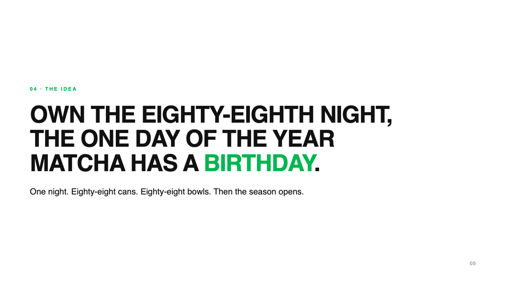
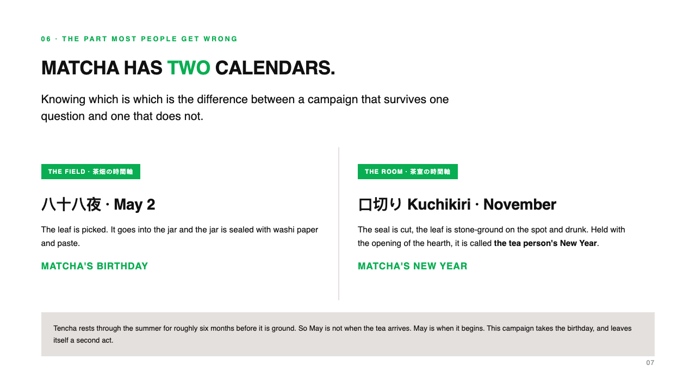
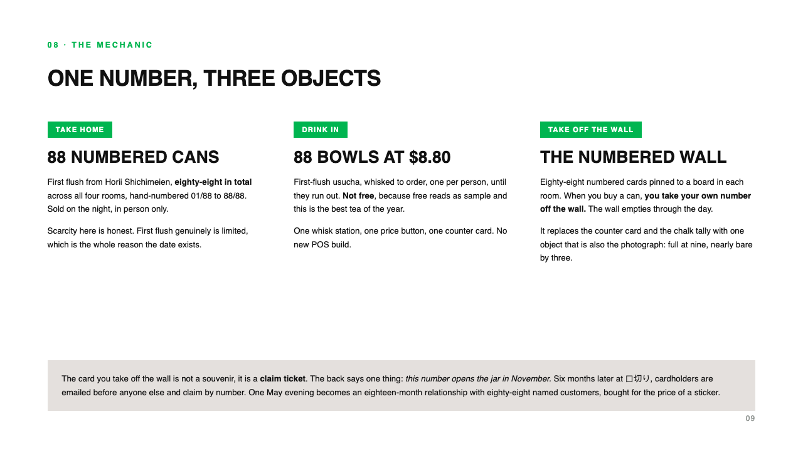
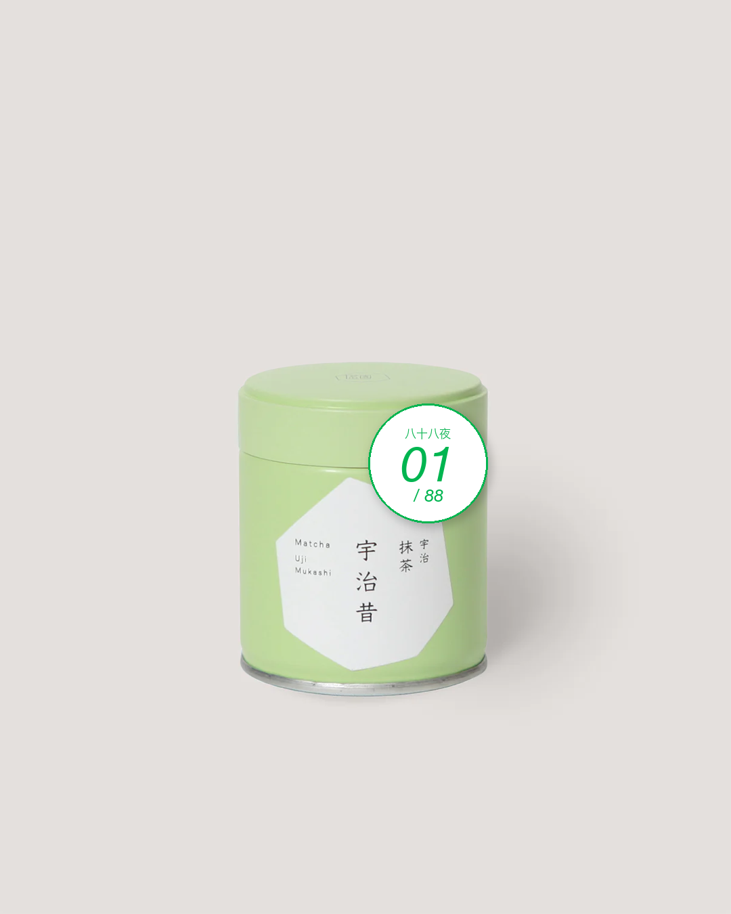
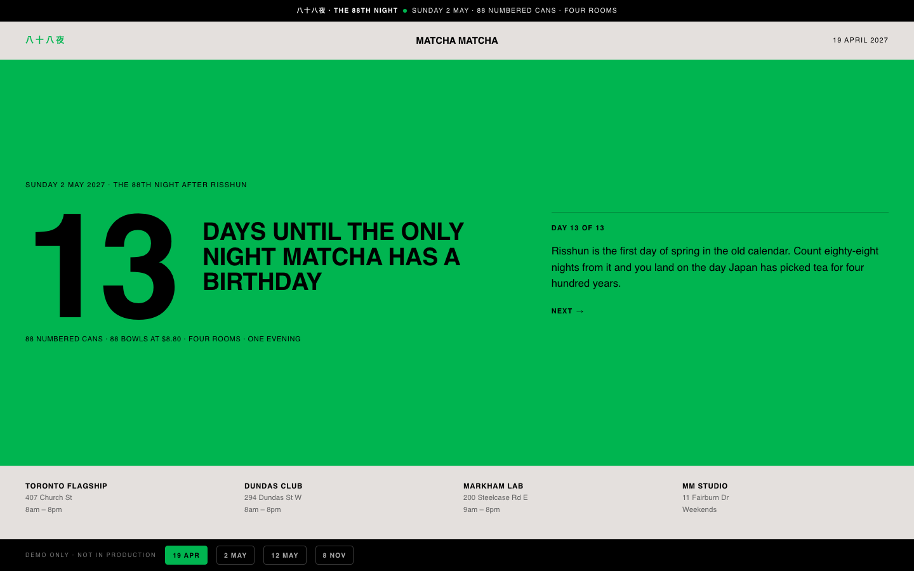
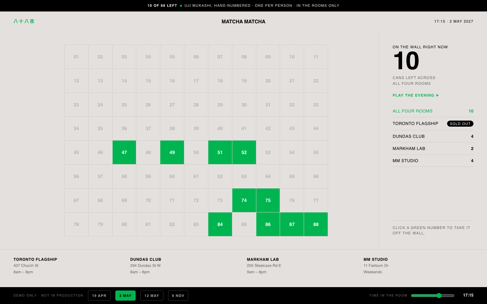
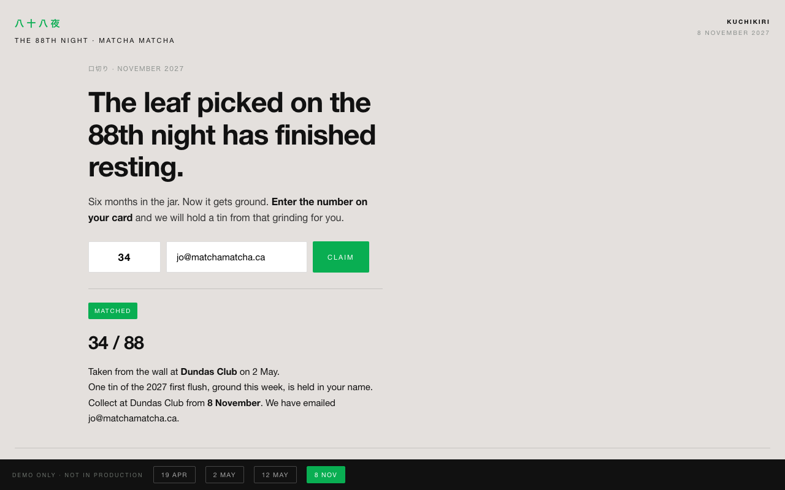
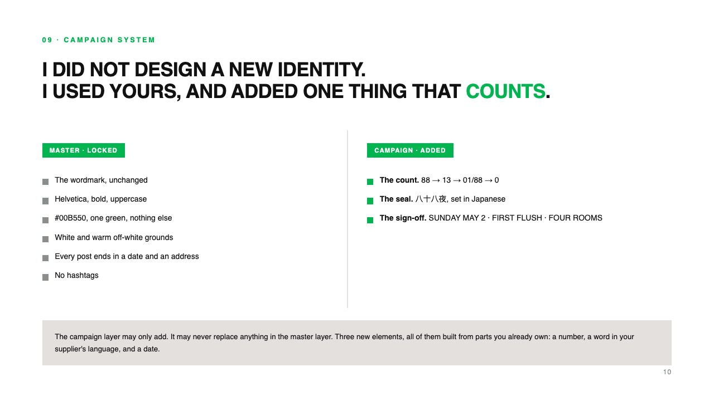
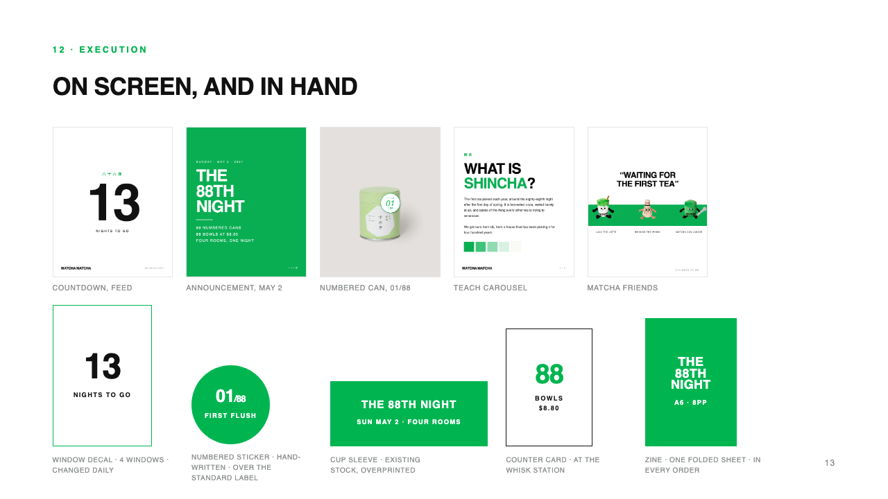

## A — THE READ

MATCHA MATCHA's Instagram bio does not open with a drink. It opens with **Kyoto
Ceremonial Grade Matcha**. The shop carries five Horii Shichimeien products, up to
$108. That is not a collaboration, it is a distribution relationship. The brand reads
like a tea merchant that happens to have a café, and that is the right way round.

So the strongest thing it owns is also the least schedulable thing it owns.
"Ceremonial grade from Uji" is a claim. Claims are easy to copy and impossible to
date. **A customer cannot attend a claim.**

The pressure is real: The Matcha Tokyo opened its first Canadian store on Ossington
in May 2026, arriving with authenticity as its weapon. When a new entrant competes
on origin, the incumbent has to say its origin out loud first.

八十八夜<em>The 88th Night · Sunday, May 2, 2027</em>

## B — THE DATE

八十八夜 is the eighty-eighth night counted from *risshun*, the first day of spring.
Leaves picked around it, after twenty days under shade, are steamed and dried without
rolling into **tencha**, and tencha stone-ground is **matcha**. Uji holds an official
picking festival that morning every year. Horii Shichimeien is in Uji.

In Japan this is common knowledge. In Toronto nobody has told it.

Here is the part most people get wrong, and I nearly got wrong myself. Tencha rests
about six months before it is ground, so the tea picked on May 2 is not the tea you
drink on May 2. The field has one calendar and the tea room has another.

<!-- 这一页是整个提案里唯一能被懂行的人攻击的点，所以它不躲，它当主张用：
     把「五月没有新抹茶」这个事实，变成方案里的第二幕。 -->

八十八夜 belongs to the field. It is matcha's birthday. 口切り in November belongs to
the room, and it is the tea person's New Year. **The campaign takes the birthday and
keeps the New Year in reserve.**

## C — THE MECHANIC

Eighty-eight numbered cans. Eighty-eight bowls at $8.80. And a wall.

Eighty-eight numbered cards are pinned to a board in each room. When you buy a can,
**you take your own number off the wall.** One object replaces the counter card and
the chalk tally, and it is also the photograph: full at nine, nearly bare by three.

<!-- 编号罐是合成的，不是新拍的：堀井 Uji Mukashi 的官网产品图，
     底色正好就是品牌那个暖灰白 #E4E0DD，贴纸直接落上去。
     这是方案的论据之一 —— 没有新开模、没有新 SKU，贴纸就是产品。 -->

The card that comes with it is not a souvenir, it is a claim ticket. The back says one
thing: **this number opens the jar in November.** One May evening becomes an
eighteen-month relationship with eighty-eight named customers, bought for the price of
a sticker.

## D — THE PAGE

The wall only exists for people standing in front of it. That is the one thing print
cannot fix, and it is the reason this campaign needs a page rather than a mockup of
one.

**/88 is the wall, online.** One page, four states, driven by the date.

<iframe
  src="/88"
  title="The 88th Night — the live page"
  loading="lazy"
  style="height: 860px; background: #E4E0DD"></iframe>

Live and interactive. The black bar along the bottom is a date
switcher built for presenting, and in production the page just knows what day it is.
Try <b>2 MAY</b>, then drag the time slider.

Every cell is a card on a real wall. When somebody lifts their number in the room, it
goes dark here. Filter by room and the campaign answers a question the printed version
cannot: **if you are in Markham at four o'clock, you can see Dundas has four left.**

Three things interaction does that a printed wall cannot do at all, and the page exists
for exactly these three:

<b>Scarcity has to be visible</b><i>but a physical wall is only visible in the room</i>

<b>A number has to be claimable</b><i>but paper cannot find you six months later</i>

<b>A countdown has to change daily</b><i>but print is fixed the day it is printed</i>

## E — THE SYSTEM

The campaign does not get its own identity. It inherits MATCHA MATCHA's and adds one
thing: a number that counts down.

Six elements stay locked — the wordmark, Helvetica, the green, the warm off-white,
the photography, the caption structure with no hashtags. Three are added: the numeral
set, the 八十八夜 lockup, and the counting device. **The campaign layer may only add.
It may never replace.**

Nothing in the kit is manufactured. Printed, cut, or written by hand. The
hand-numbering is not decoration, it is the product photography. Total production:
$2,270, no paid media, no new SKU, across eight owned and earned channels.

And the eighty-eighth night happens every year. Run it once and the second year costs
nothing to explain.

> A claim can be copied by Monday. A date cannot.
